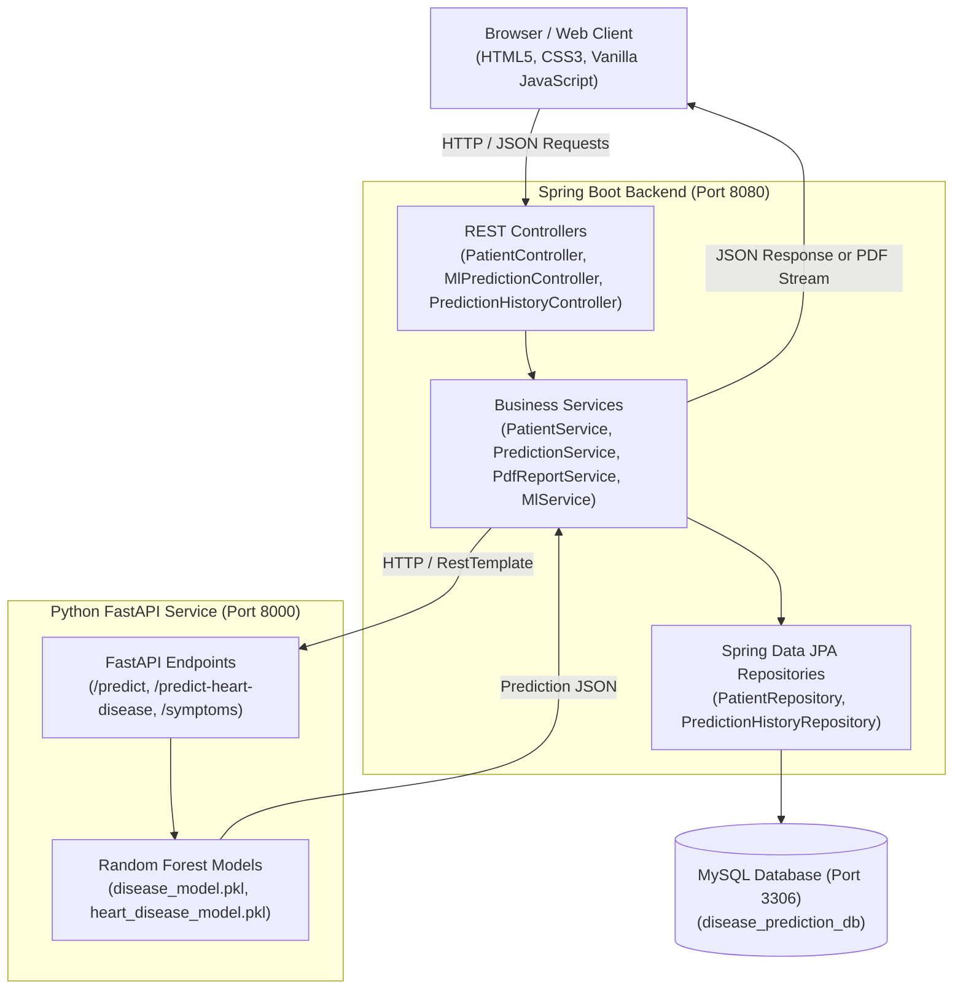
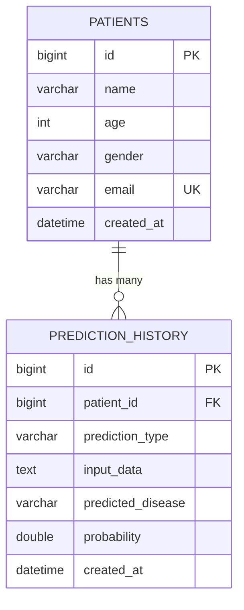

# MediPredict — Disease Prediction System

MediPredict is an end-to-end clinical decision support platform combining an enterprise Java Spring Boot backend, a Python FastAPI machine learning microservice, and a responsive web dashboard. The platform allows clinicians and healthcare operators to register patients, predict potential medical conditions from a catalog of 132 symptoms using a Random Forest classifier, evaluate cardiovascular risk from 13 diagnostic metrics, and generate downloadable PDF clinical reports.

---

## Table of Contents

- [Main Features](#main-features)
- [System Architecture](#system-architecture)
- [Technology Stack](#technology-stack)
- [Project Structure](#project-structure)
- [System Requirements](#system-requirements)
- [Database Design](#database-design)
- [Installation and Setup](#installation-and-setup)
- [Running the Project](#running-the-project)
- [REST API Documentation](#rest-api-documentation)
- [Machine Learning Models](#machine-learning-models)
- [PDF Medical Reports](#pdf-medical-reports)
- [Testing](#testing)
- [Troubleshooting](#troubleshooting)
- [Security and Configuration](#security-and-configuration)
- [Medical Disclaimer](#medical-disclaimer)
- [Author and License](#author-and-license)

---

## Main Features

- **Patient Registration & Management**: Register patient records with demographic details (name, age, gender, email) stored persistently in MySQL.
- **General Disease Prediction**: Predict potential conditions across 41 distinct disease classes by selecting observed symptoms from a catalog of 132 medical symptoms.
- **Symptom Discovery & Filtering**: Search symptoms in real-time with instant text filtering and categorized pill filters (Respiratory, Digestive, Neurological, Skin, etc.).
- **Heart Disease Prediction**: Evaluate cardiovascular risk probability using 13 clinical biomarkers and diagnostic metrics (chest pain type, resting blood pressure, cholesterol, max heart rate, ST depression, fluoroscopy vessels, etc.).
- **Patient-Specific Prediction Routing**: Predictions are tied to a specific target patient ID and automatically stored in the patient's longitudinal prediction history.
- **PDF Clinical Report Generation**: Dynamically creates publication-grade medical report PDFs using OpenPDF, including hospital header, patient demographics, prediction probability bar, and evaluated symptoms.
- **Dual-Service Architecture**: Decoupled design where Spring Boot orchestrates persistence and business logic while calling a dedicated Python FastAPI service for machine learning inference.

---

## System Architecture



---

## Technology Stack

| Layer | Technology | Details |
| :--- | :--- | :--- |
| **Backend Framework** | Java 21, Spring Boot 3.3.4 | Spring Web, Spring Data JPA, Spring Validation |
| **Object-Relational Mapping** | Hibernate 6 | Automated DDL management, relational mapping |
| **Database** | MySQL 8.0+ | Relational persistence with foreign keys and cascading |
| **Testing** | JUnit 5, Mockito, H2 Database | Unit and integration test suites |
| **PDF Generation** | OpenPDF 1.3.40 | In-memory stream generation with custom styling |
| **Build Tool** | Apache Maven 3.8+ | Dependency management and build lifecycle |
| **ML Framework** | Python 3.10+, FastAPI, Uvicorn | High-performance asynchronous REST microservice |
| **Machine Learning** | Scikit-learn, Joblib | Random Forest classifiers for disease and heart risk |
| **Data Processing** | Pandas, NumPy | Feature matrix alignment and data preparation |
| **Frontend UI** | HTML5, CSS3, Vanilla ES6 JavaScript | Zero-framework responsive dashboard with Fetch API |

---

## Project Structure

```text
disease-prediction-springboot/
├── frontend/                                   # Standalone frontend copy
│   ├── css/
│   │   └── style.css                           # Unified CSS design system & typography tokens
│   ├── js/
│   │   ├── api.js                              # Centralized Fetch API client
│   │   └── app.js                              # UI workflows, state, and event bindings
│   └── index.html                              # Dashboard interface
├── src/
│   ├── main/
│   │   ├── java/com/diseaseprediction/
│   │   │   ├── DiseasePredictionApplication.java # Spring Boot main entrypoint
│   │   │   ├── config/
│   │   │   │   ├── CorsConfig.java             # CORS security configuration
│   │   │   │   └── RestClientConfig.java       # RestTemplate bean configuration
│   │   │   ├── controller/
│   │   │   │   ├── MlPredictionController.java # Direct ML pass-through controller
│   │   │   │   ├── PatientController.java      # Patient, prediction, & PDF endpoints
│   │   │   │   └── PredictionHistoryController.java # Global prediction history
│   │   │   ├── dto/
│   │   │   │   ├── request/                    # DiseasePredictionRequest, PatientRequest, etc.
│   │   │   │   └── response/                   # DTOs for responses and errors
│   │   │   ├── exception/
│   │   │   │   ├── GlobalExceptionHandler.java # Unified HTTP error responses
│   │   │   │   ├── MlServiceException.java
│   │   │   │   └── ResourceNotFoundException.java
│   │   │   ├── model/
│   │   │   │   ├── Patient.java                # JPA Entity: patients
│   │   │   │   └── PredictionHistory.java      # JPA Entity: prediction_history
│   │   │   ├── repository/
│   │   │   │   ├── PatientRepository.java
│   │   │   │   └── PredictionHistoryRepository.java
│   │   │   └── service/
│   │   │       ├── MlService.java              # Client communication with FastAPI
│   │   │       ├── PatientService.java         # Patient CRUD operations
│   │   │       ├── PdfReportService.java       # OpenPDF document generator
│   │   │       └── PredictionService.java      # Orchestration & history persistence
│   │   └── resources/
│   │       ├── application.properties          # Production properties with env variable support
│   │       ├── application-example.properties  # Safe configuration template for public repository
│   │       └── static/                         # Static web dashboard assets served by Spring Boot
│   │           ├── css/style.css
│   │           ├── js/api.js
│   │           ├── js/app.js
│   │           └── index.html
│   └── test/
│       ├── java/com/diseaseprediction/
│       │   ├── DiseasePredictionApplicationTests.java
│       │   ├── controller/PatientControllerTest.java
│       │   └── service/                        # Unit tests for ML, Patient, Prediction, & PDF services
│       └── resources/
│           └── application.properties          # Isolated in-memory H2 test configuration
├── .gitignore                                  # Git exclusion rules
├── pom.xml                                     # Maven project descriptor
└── README.md                                   # Project documentation
```

---

## System Requirements

- **Java Development Kit (JDK)**: Version 21 (configured in `pom.xml` via `<java.version>21</java.version>`)
- **Apache Maven**: Version 3.8 or higher
- **MySQL Server**: Version 8.0 or higher
- **Python**: Version 3.10 or higher
- **Git**: Version 2.30 or higher

---

## Database Design

The relational database layer consists of two core entities configured with JPA/Hibernate annotations:



- **`patients`**: Stores primary patient demographics. `email` is enforced unique.
- **`prediction_history`**: Holds all diagnostic predictions linked to a `patient_id`. The relationship uses `CascadeType.ALL` and `orphanRemoval = true`. Input data (symptoms list or heart clinical metrics) is preserved as structured JSON text.

---

## Installation and Setup

### 1. Clone the Repository

```powershell
git clone https://github.com/Patelarfat/disease-prediction-springboot.git
cd disease-prediction-springboot
```

### 2. Configure MySQL Database

Ensure your local MySQL server is running. Create the target database:

```sql
CREATE DATABASE IF NOT EXISTS disease_prediction_db
  CHARACTER SET utf8mb4
  COLLATE utf8mb4_unicode_ci;
```

### 3. Configure Spring Boot Environment

Spring Boot reads connection settings from `src/main/resources/application.properties`. To avoid committing credentials, the project uses environment variables:

```powershell
# Set database credentials in your current PowerShell session:
$env:DB_URL = "jdbc:mysql://localhost:3306/disease_prediction_db?createDatabaseIfNotExist=true&useSSL=false&serverTimezone=UTC&allowPublicKeyRetrieval=true"
$env:DB_USERNAME = "root"
$env:DB_PASSWORD = "YOUR_MYSQL_PASSWORD"
```

*(Alternatively, reference `src/main/resources/application-example.properties` as a guide.)*

### 4. Setup Python ML Microservice

The Python FastAPI microservice is located in the companion repository/directory `disease-prediction-ml`:

```powershell
# Navigate to the Python ML project directory
cd ..\disease-prediction-ml

# Install required Python packages
pip install -r requirements.txt
```

---

## Running the Project

Run both services in separate terminal windows:

### Terminal 1: Python FastAPI ML Service (Port 8000)

```powershell
cd D:\Buildathon2.0\Project2\disease-prediction-ml
python -m uvicorn backend.app:app --host 0.0.0.0 --port 8000 --reload
```

- Verifiable at: `http://localhost:8000/docs` (Swagger UI)

### Terminal 2: Spring Boot Application (Port 8080)

```powershell
cd D:\Buildathon2.0\Project2\disease-prediction-springboot
mvn spring-boot:run
```

### Access the Web Application

Open your browser to:
```text
http://localhost:8080/
```

---

## REST API Documentation

All Spring Boot endpoints are mapped under `/api`:

### 1. Patient Endpoints

| Method | Endpoint | Description |
| :--- | :--- | :--- |
| `POST` | `/api/patients` | Register a new patient. Requires `name`, `age`, `gender`, optional `email`. |
| `GET` | `/api/patients` | Retrieve all registered patients. |
| `GET` | `/api/patients/{id}` | Retrieve a single patient by primary key. |

### 2. Clinical Prediction Endpoints (Patient-Specific & Persisted)

| Method | Endpoint | Description |
| :--- | :--- | :--- |
| `POST` | `/api/patients/{patientId}/predict` | Runs general disease inference for selected symptoms, saves result to history, and returns diagnosis. |
| `POST` | `/api/patients/{patientId}/predict-heart-disease` | Runs heart disease risk inference for 13 diagnostic metrics and saves result to history. |
| `GET` | `/api/patients/{patientId}/predictions` | Retrieves all prediction history records for a patient (newest first). |
| `GET` | `/api/patients/{patientId}/predictions/{predictionId}/report` | Generates and streams a downloadable PDF medical report (`application/pdf`). |

### 3. Machine Learning Pass-Through Endpoints

| Method | Endpoint | Description |
| :--- | :--- | :--- |
| `GET` | `/api/ml/symptoms` | Fetches the list of all 132 symptoms recognized by the model. |
| `POST` | `/api/ml/predict` | Direct prediction without linking or saving to a patient profile. |
| `POST` | `/api/ml/predict-heart-disease` | Direct heart prediction without linking or saving to a patient profile. |
| `GET` | `/api/predictions` | Retrieves global prediction records across all patients. |

---

## Machine Learning Models

### Model Architecture
- **General Disease Classifier**: A Random Forest classifier trained on 132 binary symptom indicators across 41 disease classes (`disease_model.pkl`).
- **Cardiovascular Risk Classifier**: A Random Forest classifier evaluating 13 numerical and clinical biomarkers (`heart_disease_model.pkl`).

Both models are pre-trained scikit-learn estimators serialized with joblib and served with high-performance asynchronous endpoints via FastAPI.

---

## PDF Medical Reports

The platform uses **OpenPDF** (`com.github.librepdf:openpdf:1.3.40`) to generate on-demand clinical summary reports. Features include:
- Professional hospital document layout with document timestamp and unique record identifiers.
- Complete patient demographic summary.
- Visual confidence percentage bar with clinical urgency color coding.
- List of evaluated symptoms or diagnostic markers.
- Standard medical disclaimer footer.

Generated PDFs are streamed directly from the Spring Boot backend via `ResponseEntity<byte[]>` with `Content-Disposition: attachment; filename="MedPredict_Report_<patientId>_<predictionId>.pdf"`.

---

## Testing

The project includes unit and integration tests covering web controllers, business services, and database persistence using JUnit 5, Mockito, and an in-memory H2 database.

To execute the entire test suite:

```powershell
mvn clean test
```

### Verified Test Results
```text
[INFO] Results:
[INFO] Tests run: 24, Failures: 0, Errors: 0, Skipped: 0
[INFO] BUILD SUCCESS
```

Key test suites:
- `PatientControllerTest`: Verifies REST endpoints, JSON serialization, validation, and error handling.
- `PatientServiceTest`: Tests patient creation, retrieval, and validation logic.
- `PredictionServiceTest`: Validates end-to-end prediction workflows, JPA persistence, and history queries.
- `PdfReportServiceTest`: Tests PDF byte generation, document structure, and error handling.
- `MlServiceTest`: Tests mock communication with FastAPI and exception handling.

---

## Troubleshooting

### 1. MySQL Connection Refused
- **Symptom**: `CommunicationsException: Communications link failure` or `Access denied for user`.
- **Solution**: Confirm MySQL is running on port 3306. Check that the database `disease_prediction_db` exists and verify your `$env:DB_PASSWORD`.

### 2. Port 8080 or Port 8000 Already in Use
- **Symptom**: `Web server failed to start. Port 8080 was already in use.`
- **Solution**: Identify and stop the occupying process:
  ```powershell
  # Find PID for port 8080:
  netstat -ano | findstr :8080
  # Stop the process:
  Stop-Process -Id <PID> -Force
  ```

### 3. Python ML Service Unavailable
- **Symptom**: Spring Boot logs `ResourceAccessException: I/O error on POST request for "http://localhost:8000/predict"`.
- **Solution**: Ensure the FastAPI server is active in Terminal 1. Visit `http://localhost:8000/docs` in your browser to verify it responds.

### 4. Missing Python Dependencies
- **Symptom**: `ModuleNotFoundError: No module named 'fastapi'` or `'sklearn'`.
- **Solution**: Re-install dependencies inside the ML directory:
  ```powershell
  pip install -r requirements.txt
  ```

---

## Security and Configuration

1. **Database Secrets**: Never hardcode database credentials in `application.properties`. Always supply `DB_PASSWORD` through environment variables or a secured secret vault in production.
2. **Template File**: An illustrative configuration template with placeholder tokens is provided at [`src/main/resources/application-example.properties`](file:///d:/Buildathon2.0/Project2/disease-prediction-springboot/src/main/resources/application-example.properties).
3. **CORS Policy**: Configured in [`CorsConfig.java`](file:///d:/Buildathon2.0/Project2/disease-prediction-springboot/src/main/java/com/diseaseprediction/config/CorsConfig.java) to allow cross-origin requests for local development.

---

## Medical Disclaimer

> **DISCLAIMER**: MediPredict is an educational software engineering and research project. The predictions and probability estimates generated by this system are produced by statistical machine learning models and are intended solely for academic demonstration and clinical decision support research. This software is **not** a certified medical diagnostic device and must **not** be used as a substitute for professional clinical judgment, medical diagnosis, or patient treatment planning.

---

## Author and License

- **Author**: Arfat Patel
- **GitHub**: [@Patelarfat](https://github.com/Patelarfat)
- **Repository**: [https://github.com/Patelarfat/disease-prediction-springboot](https://github.com/Patelarfat/disease-prediction-springboot)

Developed for Buildathon 2.0.
